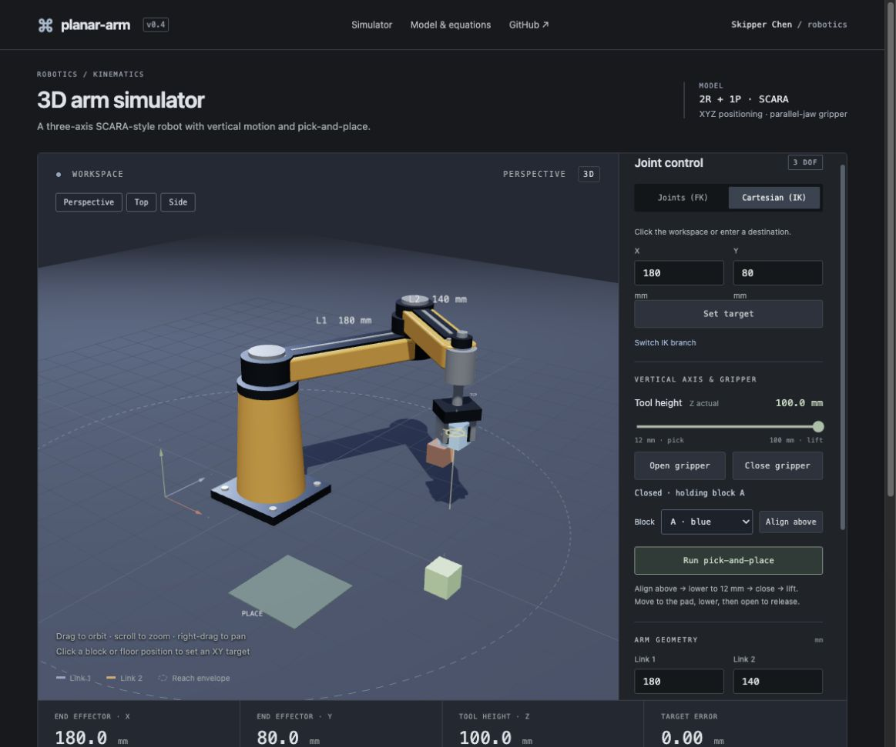

# 3D Arm Simulator

A browser-based 3D SCARA-style robot simulator with orbit controls, forward/inverse kinematics, joint-speed limits, vertical motion, a parallel-jaw gripper, and pick-and-place. Created for Skipper Chen's engineering learning portfolio with AI assistance.

**[Launch the simulator](https://niceskipperchen-coder.github.io/robotic-arm-simulator/)** · [Source code](https://github.com/niceskipperchen-coder/robotic-arm-simulator)



## Features

- Inspect a solid 3D robot with a pedestal, actuators, machined links, gripper, lighting, and shadows.
- Orbit, pan, and zoom the camera independently of the robot.
- Switch between perspective, top, and side camera views.

- Control shoulder and elbow angles directly.
- Set grip-center height from 12 to 100 mm with a sliding vertical tool axis.
- Open and close the gripper to grasp, lift, carry, and release three blocks.
- Run a complete pick-and-place sequence onto a placement pad.
- Click the workspace or enter Cartesian coordinates to solve inverse kinematics.
- Switch between the two elbow configurations.
- Change link lengths and inspect the reachable workspace.
- Run a circular path and visualize the end-effector trail.
- Inspect actual Cartesian position and the distance to the requested target.
- Set a joint-speed ceiling and observe its effect on path tracking.
- Read the equations and model assumptions.

## Quick start

Requires Python 3 for the preview and Node.js 18+ for tests. No package installation is needed. A modern browser with WebGL 2 and hardware acceleration is required. Three.js 0.180.0 and OrbitControls are vendored locally, so the simulator does not depend on a runtime CDN.

```sh
npm start
```

Open http://localhost:4173. Run `npm test` for the kinematics tests.

The application lives in `dist/` and can be served by any static web host. The interface uses system fonts.

## Robot model

This is a three-axis revolute–revolute–prismatic (2R + 1P) SCARA-style mechanism. The two vertical rotation axes position the wrist in XY, and a sliding tool shaft controls the grip-center height Z (12–100 mm). Link 1 rotates at a fixed elevation of 140 mm; link 2 is offset 30 mm higher. A parallel-jaw gripper opens and closes below the wrist. There is no independent wrist rotation.

The base is at XY (0, 0). World Z is height above the floor; XY orientation is shown by the scene axes. Three.js uses Y for elevation internally, so planar (x, y) maps to rendered (x, height, -y). Link lengths and positions are millimetres. Shoulder and elbow values are degrees, with the elbow relative to link 1 and positive rotation counterclockwise viewed from above.

Forward kinematics:

```
x = L1 cos(theta1) + L2 cos(theta1 + theta2)
y = L1 sin(theta1) + L2 sin(theta1 + theta2)
```

Inverse kinematics uses the law of cosines:

```
c2 = (x*x + y*y - L1*L1 - L2*L2) / (2*L1*L2)
theta2 = +/- acos(c2)
theta1 = atan2(y, x) - atan2(L2*sin(theta2), L1 + L2*cos(theta2))
```

Targets are reachable when `abs(L1-L2) <= hypot(x,y) <= L1+L2`. Most points have two solutions; at full extension or folding the branches meet. The simulator rejects unreachable targets rather than moving to an incorrect point.

## Scope and limitations

This is a kinematic visualization, not a validated physical robot controller. Each joint moves at up to the selected angular speed (15–180 degrees per second). This is a velocity ceiling, not a motor dynamics or trajectory-optimization model. Acceleration is not modeled. Reduced-motion mode applies poses immediately. The vertical axis moves at up to 60 mm/s. The object model applies gravity at 9810 mm/s² and inelastic floor contact. It does not simulate torque, inertia of the robot, friction, collisions with the robot, block-to-block collisions, stacking, joint stops, or motor control. Both links can rotate through a full turn. Intermediate joint motion is not guaranteed to follow a straight Cartesian path.

## Verification

The 17 automated tests cover known forward positions, both inverse branches, unreachable targets, boundary positions, invalid input, speed limits, overshoot, angle wrapping, mapping planar coordinates into the 3D workspace, grasp alignment, attachment, release, and floor contact. The browser interface should also be checked with sliders, target entry, the demo, and a narrow viewport after changes.

## Learning and authorship

The initial interface, implementation, and tests were generated with Codex assistance. This repository is a starting point for learning and experimentation; it does not claim independent hardware construction or completed student research.

Suggested experiments to document yourself:

1. Predict a position by hand and compare it with the simulator.
2. Explain why one target can have two elbow configurations.
3. Change link lengths and compare the inner unreachable region.
4. Measure Cartesian tracking error during the circular path.
5. Extend the model with joint limits or a third link, recording your design choices and tests.

Keep a project log with your own observations, screenshots, calculations, and changes before presenting it as application evidence.

## References

- [Robotics Toolbox for Python](https://github.com/petercorke/robotics-toolbox-python): reference for model-first documentation and explicit capabilities.
- [Mithi’s Hexapod simulator](https://github.com/mithi/hexapod): reference for an interactive robotics project with usage documentation.

These informed the project presentation. No source code or visual assets were copied from either repository.

## Project structure

```text
dist/
  index.html        Simulator UI and model documentation
  style.css         Responsive layout
  app.js            Simulation state and UI coordination
  view3d.js         Three.js robot meshes, camera, lighting, and picking
  coordinates.js    XY to 3D workspace coordinate mapping
  vendor/           Three.js, OrbitControls, and MIT license
  kinematics.js     Forward and closed-form inverse kinematics
  motion.js         Speed-limited joint stepping
  manipulation.js   Grasp alignment, attachment, gravity, and floor contact
tests/
  kinematics.test.js
  motion.test.js
  coordinates.test.js
  manipulation.test.js
.github/workflows/checks.yml
```

## Camera controls

| Action | Mouse / trackpad | Touch |
| --- | --- | --- |
| Orbit | Left-drag | One-finger drag |
| Zoom | Scroll wheel / pinch | Two-finger pinch |
| Pan | Right-drag | Two-finger drag |
| Select an IK target | Click without dragging | Tap |

Clicking a block selects its center in XY; clicking elsewhere selects an XY target on the floor. Height is commanded separately. Dragging and multi-touch camera gestures do not command the arm. Camera presets provide keyboard-accessible viewpoint changes; the joint and target inputs are also keyboard accessible.

## Third-party components

[Three.js and OrbitControls](https://threejs.org/) are used under the MIT license. The pinned distribution and its license are included under `dist/vendor/`. The 3D robot model is constructed procedurally for this project; it is not a manufacturer-accurate CAD model.

## Pick and place

1. Choose a block (A, B, or C), then press **Align above**. This raises the tool and aligns its XY position.
2. Open the gripper, lower **Tool height** to 12 mm, and wait for the tool to reach the cube center.
3. Press **Close gripper**. The status confirms which block is attached.
4. Raise the tool, move to another XY position, and lower to 12 mm.
5. Press **Open gripper** to release. A release from above the floor falls under gravity.

**Run pick-and-place** performs the open → raise → approach → lower → grasp → lift → transfer → lower → release → retract sequence for the selected block. Stop preserves the gripper state; Reset returns all three blocks to their starting positions. Changing geometry releases a held block.

Grasp attachment requires the grip center to be within 8 mm horizontally and 6 mm vertically of a block center. A held block follows the tool position through a simplified attachment constraint. No contact-force or friction solver is used. Gripper opening does not count as an additional positioning degree of freedom.
